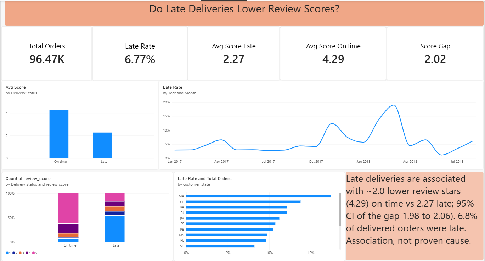
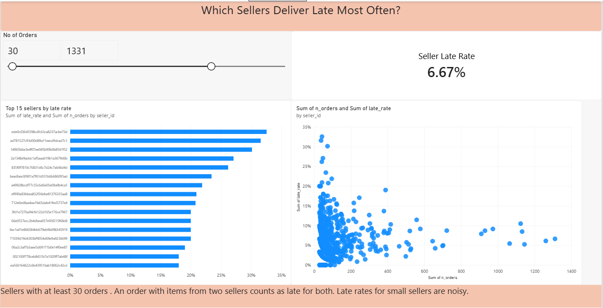
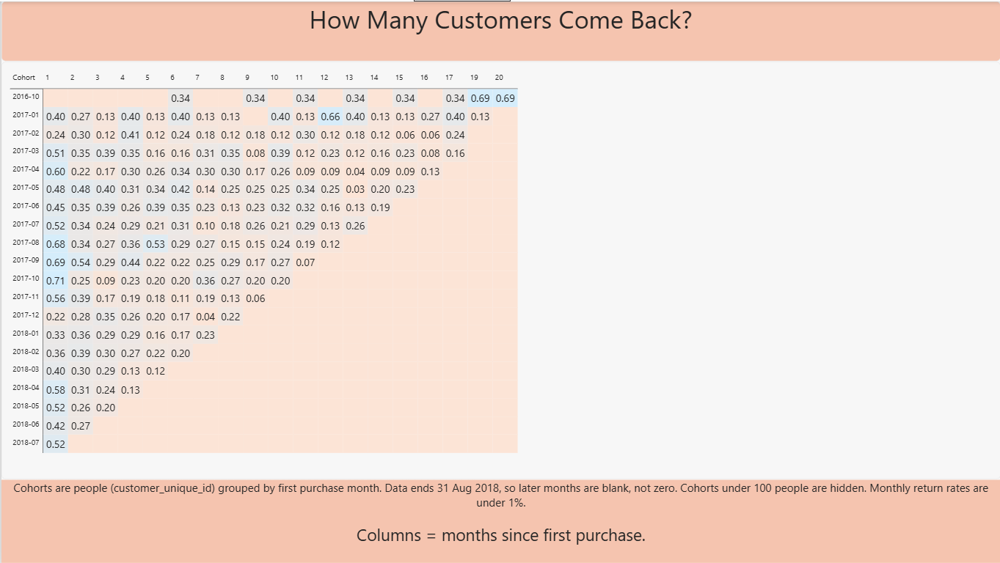

# Do late deliveries lower review scores? Olist e-commerce analysis

**Question:** Do late deliveries lower customer review scores, and by how much? Can we predict which customers will buy again?

## Method

- **SQL (PostgreSQL 18):** 9 Olist CSVs (1.55M rows) loaded with `\copy`. Keys and foreign keys were added after measuring uniqueness and orphan rows. Views give one review per order and a late flag. CTE and window-function queries cover seller late-rate ranking and monthly cohort retention. All analysis SQL is in `sql/`.
- **Statistics:** Mann-Whitney U (review scores are ordinal and the two groups have different shapes), probability of superiority as the effect size, bootstrap 95% CIs (2,000 resamples), stratification by state, OLS robustness check, and a sensitivity check on the review deduplication rule.
- **ML:** predict a repeat purchase within 90 days of a cutoff date. Time-aware split, baselines first, then XGBoost with class weights, SMOTE and undersampling inside cross-validation. Judged by PR-AUC and top-1% recall, interpreted with SHAP.
- **Power BI:** 3-page dashboard built from CSVs exported from PostgreSQL (`dashboard/`).

## Key results

**Late deliveries and review scores**
- 6.77% of delivered orders (6,534 of 96,470) arrived after the estimated date.
- Mean review score: 4.29 on time vs 2.27 late, a gap of **2.02 stars** (bootstrap 95% CI 1.98 to 2.06). Median 5 vs 1. Share of 1-star reviews: 6.6% vs 53.8%.
- Mann-Whitney probability of superiority: **0.819** (95% CI 0.813 to 0.825, ties counted as half).
- The gap holds in the six largest states (probability of superiority 0.75 to 0.86, gap 1.63 to 2.33 stars) and after regression adjustment for state, price, freight, item count and seller count (coefficient -2.015, 95% CI -2.054 to -1.975).
- The result does not depend on which duplicate review is kept (gap 2.018 to 2.020).
- This is an association, not proof of cause (see Limitations).

**Sellers**
- Among sellers with 30+ orders, the top 15 by late rate are late 18% to 33% of the time, against 6.77% overall. Most have only 30 to 77 orders, so the exact ranking within the top 15 is noisy. The most reliable case is one seller with 389 orders and a 19% late rate.

**Repeat purchase**
- Repeat buying is rare: 3.04% of 94,990 customers ordered more than once. In a 90-day window only 0.56% to 0.73% of existing customers order again.
- Train cutoff 2018-03-01 (56,630 customers, 395 repeaters). Test cutoff 2018-06-01 (76,845 customers, 432 repeaters). Both windows end before the data's effective end on 31 Aug 2018.
- Final model, logistic regression on 9 numeric features: **PR-AUC 0.0201** against 0.0056 for a no-skill model (about 3.6x; 95% bootstrap CI of the lift 2.3x to 5.8x). It catches 8.1% of repeaters in the top 1% of scores (CI 5.4% to 10.7%).
- XGBoost scored 0.0161. The paired bootstrap difference (logistic minus XGBoost) is -0.0008 to 0.0092, which includes 0, so the two are not distinguishable on this test set. By cross-validation, class weights, SMOTE and undersampling did not beat plain XGBoost or logistic regression.
- SHAP on the final model: days since last order and days since first order dominate. Prior late deliveries rank last of 10 features (mean |SHAP| 0.0057 vs 0.6185 for the top feature).
- Direct check with no model: repeat rate was 0.51% for customers with a prior late delivery (5,335) vs 0.55% for those without (67,711) in the test period. The confidence intervals overlap heavily, so there is no detectable difference. Only 27 late-group customers repeated, so the data cannot rule out a modest effect.

**Retention**
- Monthly return rates are mostly 0.1% to 0.7% with no clear trend. The data effectively ends 31 Aug 2018 (16 orders in September, 4 in October).

## Dashboard
### Delivery and Reviews


### Seller Performance


### Customer Retention

## Data leakage checks

- Features use only orders placed before the cutoff date. A delivery counts as known only if it happened before the cutoff, and a review only if it was answered before the cutoff.
- The label is built only from the window after the cutoff. The test cutoff (2018-06-01) is after the training window ends (2018-05-30).
- Imputation and scaling are fitted inside the training pipeline. SMOTE and undersampling run inside each cross-validation fold.
- The customer ID is the person ID (`customer_unique_id`), not the per-order `customer_id`.
- Model choice used cross-validation on the training set, not test scores.
- Known remaining issue: orders are filtered by their final status (canceled or unavailable are dropped), which uses information from after the cutoff.
- The same customer can appear in both train and test with different features.

## Limitations

- Late orders may also be orders where something else went wrong (wrong item, damage). The data has no measure of product quality, so this is an association and not a causal estimate.
- Only customers who left a review are observed.
- "Late" compares the delivery date with Olist's own estimate, using dates and not timestamps.
- An order with items from two sellers counts as late for both.
- Cross-validation on the training set is random, not time-aware, so it is optimistic. Test numbers are the honest ones.
- Customer state was dropped after inspection: the three highest-impact states had 1, 1 and 2 positives in training. Results with state are in the notebook as an ablation.
- Only 395 training and 432 test repeaters, so all model metrics have wide intervals.

## Repo structure

```
sql/          numbered SQL files (schema, load, constraints, views, analysis, exports)
notebooks/    01_stats.ipynb (Phase 2), 02_repeat_purchase.ipynb (Phase 3)
dashboard/    Power BI file and page screenshots (exported CSVs are gitignored)
data/         raw CSVs (gitignored, download from Kaggle)
```

## Reproduce

1. Download "Brazilian E-Commerce Public Dataset by Olist" from Kaggle into `data/`.
2. Create a `.env` file with `PGHOST`, `PGPORT`, `PGDATABASE`, `PGUSER`, `PGPASSWORD`.
3. From the project root:
```
psql -U postgres -c "CREATE DATABASE olist;"
psql -U postgres -d olist -f sql/01_schema.sql
psql -U postgres -d olist -f sql/02_load.sql
psql -U postgres -d olist -f sql/04_constraints.sql
psql -U postgres -d olist -f sql/05_views.sql
```
   `03` and `06` to `11` are check and analysis queries. `12` to `15` are used by the notebooks. `16` and `17` export the Power BI tables.
4. `pip install -r requirements.txt`, then run the notebooks in order.